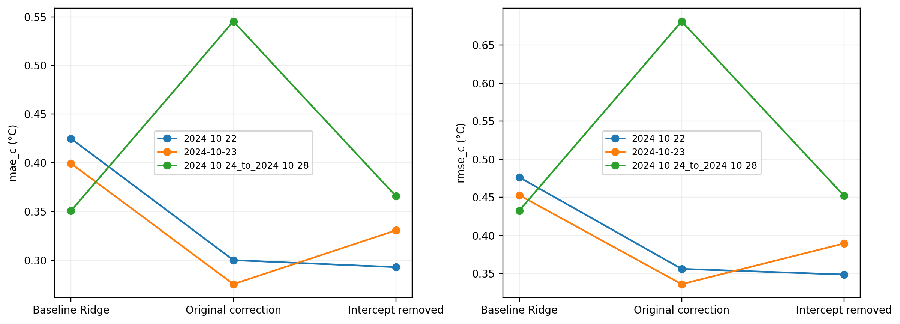

# Thermal ML: compact temperature forecasting and correction

Predict CPU temperature 60 seconds ahead from 30 seconds of causal telemetry. A frozen Ridge or small neural baseline receives three standardized physics-inspired residual features: superlinear temperature dependence, radiation-inspired curvature and temperature–power interaction. Their coefficients are effective predictive parameters, not identified heat-transfer constants.

**Workflow:** obtain publisher recordings → prepare locally → replay saved models → verify frozen references → generate report tables. Fitting is optional and separate.

| Evidence scope | Comparison | MAE baseline → correction (°C) | RMSE baseline → correction (°C) |
|---|---|---:|---:|
| Original fixed split: Jetson | Ridge | .350547 → .298300 | .432464 → .371303 |
| Original fixed split: Jetson | H2 neural | .278323 → .291615 | .428505 → .401240 |
| Original fixed split: Intel | Ridge | 4.761378 → 4.442720 | 6.427620 → 5.969387 |
| Original fixed split: Intel | H2 neural | 4.007321 → 3.996765 | 5.444764 → 5.421095 |
| Jetson grouped, three folds | Ridge original correction | .391497 ± .037690 → .373550 ± .149162 | .453806 ± .021906 → .457705 ± .193723 |
| Intel grouped, three dates | Ridge original correction | 4.122811 ± .634884 → 3.948181 ± .577410 | 5.625935 ± .753218 → 5.323949 ± .674343 |
| Intel grouped, three dates | H2 neural correction | 3.554648 ± .439270 → 3.550943 ± .427297 | 4.762842 ± .690632 → 4.743524 ± .681034 |
| Jetson supplementary grouped | H2 neural correction | .380114 ± .171089 → .487827 ± .365679 | .493108 ± .251819 → .685235 ± .599617 |
| Jetson grouped, retrospective refinement | Ridge intercept removed | .391497 ± .037690 → .329744 ± .036439 | .453806 ± .021906 → .396679 ± .052060 |



**Retrospective intercept-removal refinement, evaluated on all three existing grouped folds without refitting.** It removes the saved correction intercept at prediction time: original δ=α(c+γᵀφ), refined δ=αγᵀφ. The evaluated Ridge α is 1. It does not refit slopes, recenter features, alter the baseline or train a zero-intercept model. It was introduced after diagnosing the original grouped failure, not selected before that evaluation. Mean fold MAE/RMSE reductions are 15.77%/12.59% relative to baseline (reductions of mean errors, not means of fold percentages). Both metrics improve in two of three folds; late October remains slightly worse. It has not been independently confirmed or evaluated on Intel or neural models.

The original correction remains visible. Full Intel grouped, all neural seeds, bounds, generic comparators, supplementary Jetson and adverse outcomes are in `report_outputs/` and frozen experiment tables. Original Jetson λ=1 telemetry Ridge is a different comparator from the sequential λ=10 receiver. H2 means a two-hidden-unit network, not physics-enriched Ridge.

## Setup and source acquisition

Python 3.9–3.11; CPU only, one numerical thread. From this folder:

```sh
python3 -m venv .venv
source .venv/bin/activate
python -m pip install -r requirements.txt
mkdir -p local_sources
```

Obtain files directly under publisher terms; no data are bundled or downloaded automatically.

**Jetson:** BroncoSpace Lab / SCALES contributors, [repository](https://github.com/BroncoSpace-Lab/scales-docs), pinned commit `f78280e6995e3c62488ea32f4dd7bfc5990370d8`. No explicit license file was found at that pinned snapshot; public availability is not redistribution permission.

```sh
git clone https://github.com/BroncoSpace-Lab/scales-docs.git local_sources/scales-docs
git -C local_sources/scales-docs checkout f78280e6995e3c62488ea32f4dd7bfc5990370d8
python -B run.py fixed jetson --source-dir local_sources/scales-docs
```

The 20 required raw/window files and hashes are in `fixed/jetson/manifests/sources.json`. The original parser and author-window alignment produce 2,714 development and 1,457 held-out origins. The launcher checks bytes and replays original saved models.

**Intel:** Ahmed Abd Elaziz Elsayed, Abdullah Azhar Al-Obaidi and Hany E. Z. Farag, [article](https://doi.org/10.1038/s41597-026-07496-6), [Figshare v1](https://doi.org/10.6084/m9.figshare.31654879.v1), [source repository](https://github.com/Ahmed-Elsayed95/High-resolution-AI-Data-Center-Training-Workloads-Dataset).

```sh
git clone https://github.com/Ahmed-Elsayed95/High-resolution-AI-Data-Center-Training-Workloads-Dataset.git local_sources/intel-workloads
git -C local_sources/intel-workloads checkout f7f8d62e806ce2b64e93c58fce2bb18604f067ad
python -B run.py fixed intel --source-dir local_sources/intel-workloads
```

`fixed/intel/manifests/download_manifest.json` lists the 40 required single-machine sources and hashes. Original preparation excludes four invalid captures and produces 24,554 development and 6,035 held-out origins. Figshare lists CC BY 4.0; the tested GitHub snapshot has a separate CC BY-NC-ND 4.0 notice. These are not assumed interchangeable. Figshare archive layout/byte equivalence was not tested. Read the preserved notices in `fixed/reference/` and the full acquisition details in `fixed/README.md`.

## Saved-model replay: no fitting

After preparation:

```sh
python -B run.py fixed jetson
python -B run.py fixed intel
python -B run.py grouped all
python -B run.py refinement
python -B run.py report
```

Grouped datasets can also be replayed separately: `python -B run.py grouped jetson_inference` or `python -B run.py grouped intel`. Refinement regenerates predictions from saved models, training-derived coordinates and prepared observations, never from a diagnostic predictions CSV. `report` requires both primary datasets plus refinement; supplementary aggregate evidence is reused and labelled separately.

## Optional original fitting routes

```sh
python -B run.py fixed intel --refit-check
python -B run.py grouped all --refit --output-dir grouped/local/refit_results
```

Use a new output directory for a fresh grouped refit. Existing scientific functions, seeds and budgets are unchanged. No grid search occurs. Complete original Jetson fixed-split nested selection is not supplied; its saved-model replay is. Supplementary Jetson raw preparation/refitting is not implemented in this publication package: its aggregate/per-recording/seed evidence and previous verification are retained, without inventing a new workflow.

## Structure and verification

| Directory | Purpose |
|---|---|
| `fixed/` | Original portable source preparation/replay, models, original comparisons and notices |
| `grouped/` | Existing grouped fitting/scoring code, configuration, groups/folds; `results/` is frozen reference evidence |
| `refinement/reference/` | Independently frozen diagnostic metrics; original signs preserved |
| `*/local/` | Regenerated observations, predictions and checks, ignored by Git |
| `report_outputs/` | Aggregate/per-recording CSVs and PDF/PNG figures, no temperature traces |
| `VERIFICATION.md`, `package_manifest.json` | What was rerun, limits and file hashes |

`fixed/README.md` and `grouped/README.md` preserve historical release documentation; use this root launcher's commands instead of the old companion-folder instructions. Original scientific code has not been refactored.

Tests after preparation:

```sh
(cd fixed && python -B -m unittest test_run.py)
(cd fixed && python -B -m unittest discover -s intel -p test_run.py)
(cd grouped && python -B -m unittest test_run.py)
```

Grouped replay additionally checks excluded-group residuals, preprocessing, bounds, saved receiver hashes, identical origins and frozen seed/per-recording references. Summaries score seeds first, average within folds, then report equal-fold means and sample SD (ddof=1). Seed variability is separate from fold variability. Positive **improvement** means baseline minus method; historical fixed `minus_comparator`/`minus_paired` and refinement-reference `change_*` columns use the opposite sign.

Jetson is “three-fold grouped cross-validation with previously selected, fixed hyperparameters”: retrospective robustness assessment, not fully nested model-selection validation. Intel uses fixed-configuration leave-one-date-out evaluation. The 15-window supplementary inference/training-workload scope is separate from the 10-window inference-only scope. Dates/workloads and group sizes differ; overlapping origins and seeds are not independent replicates. No pooled Jetson/Intel scores, mechanism proof or measured energy savings are claimed.

## Credits and publication boundary

Original code remains MIT under the existing contributor attribution in `LICENSE`; MIT does not relicense datasets, notices or publications. Source terms/citations and previously verified links are preserved. No repository URL, DOI or arXiv ID is invented for this software.

The public folder/ZIP excludes publisher recordings, archives, prepared observations/targets, row-level predictions and measured traces. Those are generated locally and must remain out of uploads. See the actual ZIP audit in `VERIFICATION.md`; `.gitignore` alone is not a redistribution check. Reports and white papers are not edited or bundled. Nothing has been pushed or published.
