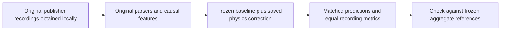
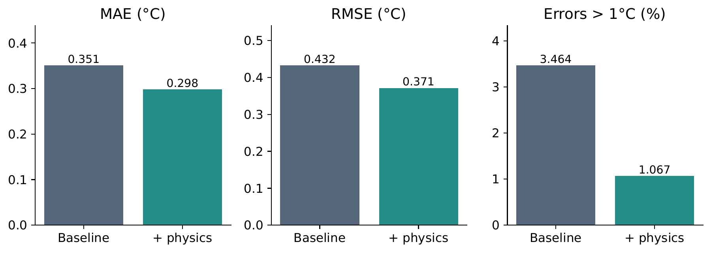

# Thermal ML: small physics-inspired corrections

Forecast CPU temperature 60 seconds ahead from 30 seconds of causal telemetry. A frozen Ridge or small neural predictor receives a learned, three-feature thermal correction. The features express superlinear temperature dependence, radiation-inspired curvature and temperature–power interaction; their fitted coefficients are predictive parameters, not measured material constants.



| Held-out comparison | Baseline MAE → corrected MAE (°C) | Baseline RMSE → corrected RMSE (°C) |
|---|---:|---:|
| Jetson sequential Ridge | 0.350547 → 0.298300 (**14.90% lower**) | 0.432464 → 0.371303 (**14.14% lower**) |
| Jetson H2 neural network | 0.278323 → 0.291615 (**4.78% higher**) | 0.428505 → 0.401240 (**6.36% lower**) |
| Intel fixed Ridge | 4.761378 → 4.442720 (**6.69% lower**) | 6.427620 → 5.969387 (**7.13% lower**) |
| Intel H2 neural network | 4.007321 → 3.996765 (**0.26% lower**) | 5.444764 → 5.421095 (**0.43% lower**) |

These are comparisons against each correction's exact frozen receiver. Jetson's original λ=1 telemetry Ridge has MAE 0.259163°C; the highlighted sequential receiver uses λ=10. The full original comparator context, bounded corrections and neural widths remain in the regenerated metrics. H2 means a two-hidden-unit neural network, not physics-enriched Ridge.



## Setup

Python 3.9–3.11; one CPU numerical thread; no GPU needed. From this folder:

```sh
python3 -m venv .venv
source .venv/bin/activate
python -m pip install -r requirements.txt
```

On Windows activate `.venv\Scripts\activate`. Dependencies are pinned to the recorded numerical environment. No dataset is bundled or downloaded automatically.

## 1. Jetson: obtain recordings, prepare and evaluate

Source: **BroncoSpace Lab / SCALES project contributors**, [original repository](https://github.com/BroncoSpace-Lab/scales-docs). Read its source terms before obtaining recordings. The tested snapshot is commit `f78280e6995e3c62488ea32f4dd7bfc5990370d8`, specifically its [docs/data directory](https://github.com/BroncoSpace-Lab/scales-docs/tree/f78280e6995e3c62488ea32f4dd7bfc5990370d8/docs/data).

Obtain that revision yourself; for example, with Git:

```sh
mkdir -p local_sources
git clone https://github.com/BroncoSpace-Lab/scales-docs.git local_sources/scales-docs
git -C local_sources/scales-docs checkout f78280e6995e3c62488ea32f4dd7bfc5990370d8
python -B run.py jetson --source-dir local_sources/scales-docs
```

Alternatively, use GitHub's download at that exact revision and pass the extracted repository root. Only the 20 source files listed with URLs, byte counts and hashes in `jetson/manifests/sources.json` are required: raw `.txt` recordings and corresponding author-selected `.csv` windows for the ten original recordings. Do not substitute CSV temperatures for the raw CPU-temperature target.

The launcher verifies source bytes; invokes the original canonical parser, author-window alignment and causal-feature functions; prepares **2,714 development and 1,457 held-out origins**; and evaluates released saved models. It requires no precomputed features, private paths or historical row-level reference predictions. Read `jetson/local/results/metrics.csv` and `verification.json`. Predictions and canonical telemetry are generated locally under the ignored `jetson/local/` directory.

## 2. Intel: obtain recordings, prepare and evaluate

Credit: **Ahmed Abd Elaziz Elsayed, Abdullah Azhar Al-Obaidi and Hany E. Z. Farag**, *Characterization of high-resolution AI data center training workloads on single and multiple GPU nodes*: [article](https://doi.org/10.1038/s41597-026-07496-6), [Figshare dataset, version 1](https://doi.org/10.6084/m9.figshare.31654879.v1), [authors' GitHub repository](https://github.com/Ahmed-Elsayed95/High-resolution-AI-Data-Center-Training-Workloads-Dataset).

The recorded experiment used the **GitHub** snapshot below. Follow that source's terms for that route; the Figshare license is not a replacement for the GitHub notice.

```sh
git clone https://github.com/Ahmed-Elsayed95/High-resolution-AI-Data-Center-Training-Workloads-Dataset.git local_sources/intel-workloads
git -C local_sources/intel-workloads checkout f7f8d62e806ce2b64e93c58fce2bb18604f067ad
python -B run.py intel --source-dir local_sources/intel-workloads
```

Only the 40 unique single-machine source files in `intel/manifests/download_manifest.json` are needed; it provides exact URLs, aliases, byte counts and Git blob hashes. The launcher accepts either the publisher's repository layout or a directory of those files named `recording_00.csv` through `recording_39.csv`, as listed by the manifest. It uses only the Intel i7-12700 / RTX 3060 subset, not H100/B200 records. Duplicate aliases are not duplicate recordings.

The **unchanged original audit and preparation functions** exclude four invalid timestamp captures and create **24,554 development and 6,035 held-out origins**. Read `intel/local/results/metrics.csv`, `summary.md`, `comparison.png` and `verification.json`. Local source copies, audit outputs, features and predictions are ignored by Git.

Figshare lists archive ID **62953543**, `High-resolution-AI-Data-Center-Training-Workloads-Dataset_FigShare.zip`, 209,685,111 bytes. Its extraction layout and equivalence to the pinned GitHub bytes were **not tested**; do not silently substitute it and bypass the manifest checks. It remains a separately attributed publisher deposit, not the tested acquisition route.

## Repeat replay, optional fitting and tests

After preparation, replay does not need source acquisition or any fitting:

```sh
python -B run.py jetson
python -B run.py intel
```

Optional **Intel only**, fixed-procedure fitting from the locally generated development features:

```sh
python -B run.py intel --refit-check
```

This refits the existing λ=10 Ridge and λ=.03 H2 models, preserves the original date-excluded residual procedure and physics/bound settings, compares against released model predictions and aggregate references, and writes `intel/local/results/refit_verification.json`. It performs no model selection and never replaces released models. The complete Jetson nested selection/refitting experiment is not packaged or claimed as verified; it is unnecessary for saved-model reproduction.

Tests, after the corresponding preparation commands:

```sh
python -B -m unittest test_run.py
python -B -m unittest discover -s intel -p test_run.py
```

The Jetson suite checks original counts and exact timestamps, paired rows, reconstruction, aggregate references, development-only scaling and causal feature invariance to future observations. The Intel suite reuses the original checks of references, metric calculations, paired origins, training groups and bounds. Each dataset is independently runnable; missing supplementary data never block these commands.

Historical row-level reference predictions are optional: place them locally at `jetson/local/reference_predictions.parquet` or `intel/local/reference_predictions.parquet` if already available. Neither workflow requires them. Newly generated predictions are always checked against independently frozen **aggregate** references, never against a reference generated from the same run. Parquet byte identity is not required.

## Package contents

| Location | Purpose |
|---|---|
| `run.py`, `test_run.py` | Thin launcher and focused portability/causality checks |
| `jetson/` | Existing parser/feature/prediction code, selected manifests, saved models and frozen metric references |
| `intel/` | Existing audit/preparation and fitting/replay code, source manifest and saved models/reference metrics |
| `reference/` | Compact supplementary outcomes, verification record and publisher license notice |
| `figures/` | Two aggregate report figures; no measured-temperature traces |
| `CODE_CHANGES.md` | Exact scope of portability changes and original-code hashes |

The companion technical report and industry white paper are not bundled in this package, and public links are not yet available. The technical report includes measured-temperature traces; the industry white paper uses aggregate comparison charts. This package supports the numerical headline evidence in both documents.

## Verification and evidence scope

Both raw-source preparation and saved-model replay routes were tested in an isolated copy using separate copies of the original publisher recordings, with no prepared features or historical predictions present. Intel fixed-procedure refitting was also tested separately. See `reference/verification.json` and `VERIFICATION.md` for exact results. Dataset downloading itself was **not** tested; publisher license metadata was checked online. The clone commands above are acquisition instructions; the preparation/evaluation commands were tested against the equivalent pinned original source bytes.

The task remains 60-second forecasting with original timestamps, gap rules, features, units, weights, splits and parameters. Jetson uses five original held-out recording windows; Intel uses seven recordings sharing one held-out date and workload family. Seed results are averaged after scoring each seed, not ensembled. Overlapping origins and seeds are not independent experimental replicates. These recordings were previously examined, so comparisons are exploratory.

Supplementary Jetson transfer and conservative grouped refitting did **not** retain aggregate gains; `reference/supplementary_metrics.csv` preserves those outcomes. Their preparation/refitting workflows are outside this focused headline package. Generic joint enrichment was competitive on Jetson; the results do not identify physical heat-transfer mechanisms or establish superiority over all nonlinear alternatives. No measured energy savings or control benefit is claimed.

## Attribution, terms and publication

Our original Python code is **MIT licensed**, as selected by the project owner; see `LICENSE`. The copied parsing, preparation and modeling scripts are from this project's own earlier research implementation, not publisher training code. Dependencies retain their own licenses. The MIT license does not relicense third-party data, notices or publications.

Publisher terms checked 26 October 2026:

- **Jetson:** no LICENSE/LICENCE/COPYING/NOTICE file was found in the pinned repository tree. This is not a grant of data redistribution rights. Obtain and use the source under applicable publisher terms; contact BroncoSpace if permission is unclear. A license on another BroncoSpace repository is not assumed to cover these recordings.
- **Intel Figshare:** the article's metadata identifies **CC BY 4.0** for its deposited dataset/archive. This statement covers that Figshare deposit, not automatically the GitHub snapshot or paper.
- **Intel GitHub:** the pinned repository's **CC BY-NC-ND 4.0** notice is preserved in `reference/intel_source_LICENSE.txt`. We record this separately and do not infer that it is interchangeable with Figshare terms or resolves scope for every repository item.

We do not collect, own, mirror or redistribute the source recordings. The folder and ZIP exclude raw telemetry, extracted features/targets, row-level predictions, source archives and measured traces. `.gitignore` also excludes local downloads, generated results, caches and environments. Keep local files out of manual web uploads; do not force-add ignored data. The published file inventory is in `reference/package_manifest.json`. Nothing has been pushed or published.

## Citation

If you use this implementation in research, please cite George-Rafael Domenikos, *Thermal ML: small physics-inspired corrections*. Machine-readable metadata is provided in `CITATION.cff`. A paper DOI, arXiv identifier and repository URL will be added when available. This citation request does not add conditions to the MIT License.
